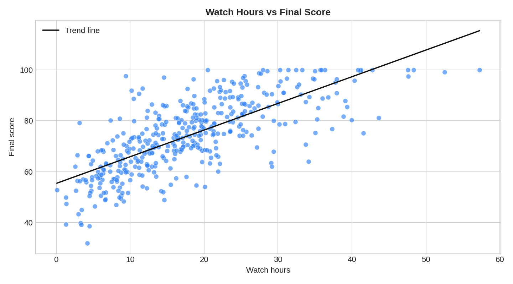
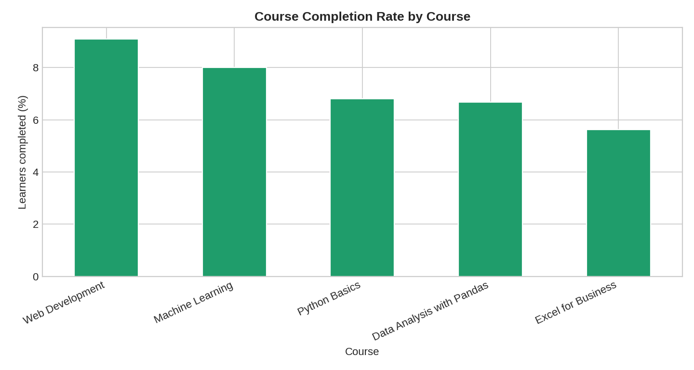

# Online Course Learning Analysis

A complete beginner-friendly **Data Science project** built with **Pandas, NumPy and Matplotlib**. It analyses how learners' watch time, lesson completion, quiz performance and satisfaction relate to course completion and final scores on an online learning platform.

> The dataset in this project is synthetic practice data generated with NumPy. It is made for learning the full workflow: data generation → cleaning → analysis → visualization → insights.

📖 **New here?** Read the full step-by-step explanation of everything in this project: [PROJECT_GUIDE.md](PROJECT_GUIDE.md)

## Project Highlights

- Generate a realistic online course dataset with **NumPy**
- Clean and explore data with **Pandas**
- Create summary tables with `groupby`, aggregation and correlation
- Build clear visualizations with **Matplotlib**
- Save charts, tables and written insights automatically

## Questions This Project Answers

1. Which course has the highest completion rate?
2. Which course produces the highest average final score?
3. Do learners who watch more hours score better?
4. Which age group completes courses most often?
5. How does satisfaction relate to performance?

## Dataset Columns

| Column | Meaning |
|---|---|
| `learner_id` | Learner ID, e.g. LRN-001 |
| `age` | Learner age, 18–45 |
| `gender` | Female / Male |
| `course` | Course enrolled in |
| `enrolled_month` | Month of enrolment in 2025 |
| `total_lessons` | Total lessons in the course |
| `lessons_completed` | Lessons the learner finished |
| `watch_hours` | Total video watch time in hours |
| `quiz_attempts` | Number of quiz attempts |
| `avg_quiz_score` | Average quiz score out of 100 |
| `assignments_submitted` | Assignments submitted |
| `satisfaction_rating` | Satisfaction rating, 1–5 |
| `final_score` | Final score out of 100 |
| `completion_status` | Completed / In Progress / Dropped |

## Project Structure

```text
online-course-learning-analysis/
├── README.md
├── requirements.txt
├── data/
│   └── online_course_dataset.csv
├── src/
│   ├── generate_dataset.py
│   └── analysis.py
├── notebooks/
│   └── online_course_analysis.ipynb
└── outputs/
    ├── insights.md
    ├── tables/
    │   ├── summary_statistics.csv
    │   ├── average_scores_by_course.csv
    │   ├── completion_by_age_group.csv
    │   └── correlation_matrix.csv
    └── charts/
        ├── completion_rate_by_course.png
        ├── watch_hours_vs_final_score.png
        ├── average_quiz_score_by_course.png
        └── satisfaction_rating_distribution.png
```

## Quick Start

```bash
git clone <your-repository-url>
cd online-course-learning-analysis
pip install -r requirements.txt
python src/generate_dataset.py
python src/analysis.py
```

After running the analysis, open:

- `outputs/insights.md` for the key findings
- `outputs/charts/` for all visualizations
- `outputs/tables/` for the summary CSV files

## Sample Visualizations





## Tools Used

- **Python**
- **Pandas** — data cleaning, grouping and analysis
- **NumPy** — synthetic data generation, trend line and numerical work
- **Matplotlib** — charts and distributions

## Future Improvements

- Replace the synthetic dataset with real learning-platform data
- Predict course completion with a simple Machine Learning model (scikit-learn)
- Build an interactive dashboard with Streamlit

## Note

This project is for Data Science practice. Correlation in this dataset does not prove causation.
